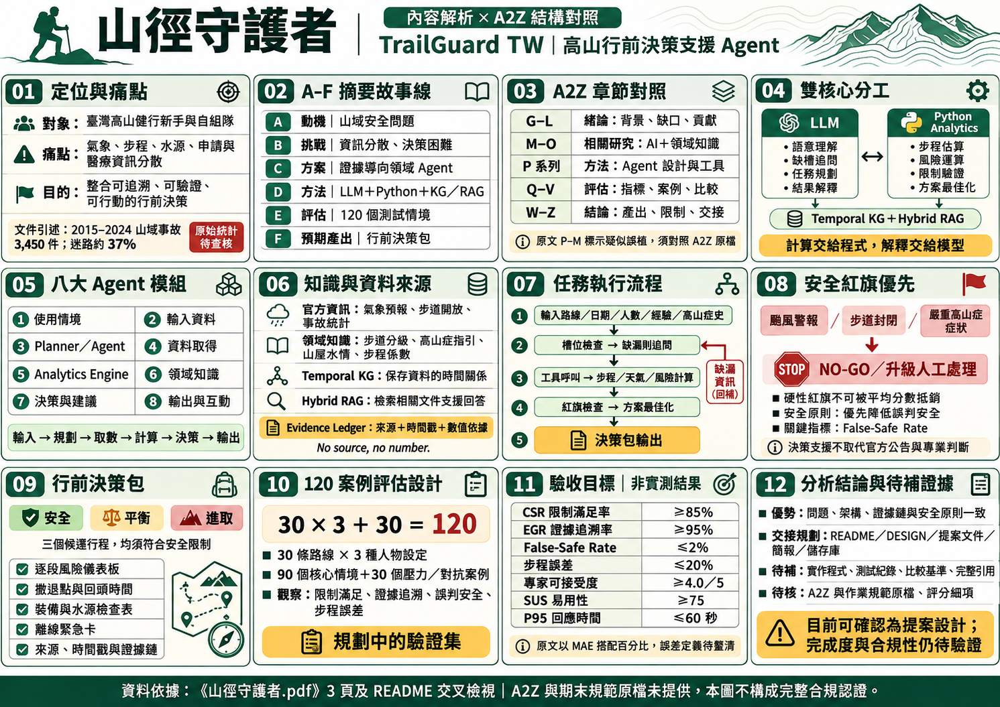

# 山徑守護者（TrailGuard TW）

**以證據為基礎的臺灣高山行程規劃與風險決策支援代理人**

> TrailGuard TW: An Evidence-Grounded Agent for High-Mountain Trip Planning and Risk-Aware Decision Support

本文件整合《山徑守護者.pdf》的三頁分析、A4 橫式編號資訊圖表，以及 IEEE Systems Journal 風格的英文摘要。內容按專案定位、A2Z 結構、系統設計、評估與交接重新整理。

**專案狀態：提案與評估設計。** 本儲存庫目前提供分析文件及圖表，尚未提供 Agent 系統程式、實驗紀錄或實測成果。文中所有驗收數字均為目標，不能視為已達成結果。

## 文件與資訊圖表

- [原始分析文件：山徑守護者.pdf](docs/山徑守護者.pdf)
- [下載 A4 橫式資訊圖表 PNG](assets/trailguard-infographic-a4-landscape.png)
- [IEEE 風格英文摘要](#ieee-abstract)
- [資料查核與限制](#source-notes)



圖表依 A4 橫式比例設計，涵蓋下列 01–12 主題。此 PNG 為資訊摘要，詳細定義與限制以本文件說明為準；並非已驗證系統的成果展示。

## 01｜專案定位、背景與痛點

TrailGuard TW 面向臺灣高山健行新手及自組隊，支援出發前的行程規劃與風險判斷，將分散資訊整理為可追溯、可覆核、可行動的行前決策。

行前資料散落於不同網站與文件，包括氣象預報、步道開放、路況、步程、水源、通訊點、入園申請與醫療指引。使用者必須自行整合，才能回答路線是否適合隊伍、天候可能在哪一段造成風險，以及何時應改道、折返或撤退。

原始文件以 2019 年開放山林後的活動與事故變化說明動機，並引述 2015–2024 年山域事故 3,450 件、迷路約占 37%，以及三大高山型國家公園事故率由 0.04–0.05% 升至 2023–2025 年的 0.08–0.09%。上述統計的來源、期間、分母與可比性仍須逐項核對，不能僅憑時間先後推論政策造成事故上升。

系統主要產出為「行前決策包」，讓使用者可以查看建議依據、限制條件與風險資訊。

## 02｜A–F 六段式摘要故事線

| 編號 | 結構 | 專案內容 |
|---|---|---|
| A | Attention Getter：動機與公開證據 | 以高山活動及山域安全問題建立研究動機，事故統計須附可核對來源。 |
| B | But：核心痛點與挑戰 | 資訊分散，缺乏整合的行前風險與撤退決策支援。 |
| C | Cure：提出方案 | 建構證據導向的領域資料代理人，服務臺灣高山行程規劃。 |
| D | Development：方法與設計 | LLM 與 Python 分工，結合時序知識圖譜、混合式 RAG 及證據帳本。 |
| E | Experiments：評估設計 | 規劃 30 條路線、3 種人物設定及 30 個壓力案例，共 120 個情境。 |
| F | Findings：預期產出 | 產出三種候選行程、風險儀表板、撤退資訊與離線緊急卡。尚無實測 findings。 |

## 03｜A2Z 章節對照與研究脈絡

下表整理原始 PDF 的結構對照；A2Z 原始文件與課程規範尚未納入本儲存庫，因此這是內容整理，不是獨立完成的合規認證。

| A2Z 對照 | 章節 | 撰寫重點 |
|---|---|---|
| G–L | Introduction | 背景、現有工具限制、研究缺口、創新貢獻與章節安排。 |
| M–O | Related Work & Deep Research | AI 技術與登山領域知識、既有方法與限制。 |
| P 系列 | Proposed Scheme / Agent Design | 使用情境、輸入、規劃、工具、演算法與輸出。 |
| Q–V | Simulation & Evaluation | 評估指標、情境、基準比較及結果分析設計。 |
| W–Z | Conclusion & Handover | 提出方案、預期產出、限制、交接與後續工作。 |

### 緒論 G–L

- **G / General：**說明臺灣高山活動與行前規劃背景。
- **H / However：**現有工具的資訊整合、計算與證據追溯能力仍待比較。
- **I / In Literature、J / Judgement：**檢視既有路線工具、生成式模型與風險評估方法；競品限制需要具體文獻或測試支持。
- **K / Keypoint & Novelty：**以 LLM／Python 分工、硬性安全紅旗及 Evidence Ledger 作為主要設計貢獻。
- **L / List Organization：**交代需求、架構、資料、方法、實作規劃與評估的章節關係。

原 PDF 將方法章標為「P–M」，疑似誤植；確切標籤仍須回查 A2Z 原檔。

## 04｜雙核心系統架構

| 元件 | 規劃職責 | 產出或檢查 |
|---|---|---|
| LLM | 理解需求、辨識缺漏資訊、規劃任務、協調工具及解釋結果 | 結構化需求、任務計畫與可讀說明。 |
| Python Analytics Engine | 步程估算、天氣窗格分析、風險運算、硬性限制驗證與方案最佳化 | 可重現的計算結果與限制檢查。 |
| Temporal Knowledge Graph | 表示路線、環境、規則與時間關係 | 協助辨識資訊時效與適用情境。 |
| Hybrid RAG | 檢索相關文件及領域知識 | 提供回答與解釋所依據的文件內容。 |
| Evidence Ledger | 記錄來源、時間戳、數值與規則依據 | 支援建議的追溯與覆核。 |

核心原則是：**計算交給程式，解釋交給語言模型；沒有來源，就不應產生確定數字。**

以上是設計分工，不代表相關元件已完成實作或測試。

## 05｜八大 Agent 模組

| 編號 | 模組 | TrailGuard TW 設計內容 | 原 PDF 所列 A2Z 對照 |
|---|---|---|---|
| ① | User Scenario | 高山行程規劃、隊伍適配與風險評估。 | PA Statement |
| ② | Query / Input | 路線、日期、人數、經驗等級及高山症既往史。 | PB Background |
| ③ | Planner & Agent | 缺槽追問、任務分解與工具調用。 | PC / PD Design |
| ④ | Data Acquisition | 氣象、步道開放、山屋水情與事故資料。 | PE Elements |
| ⑤ | Analytics Engine | 步程、天氣窗格、風險估算及路線最佳化。 | PF Formulation |
| ⑥ | Domain Knowledge | 時序知識圖譜與混合式 RAG。 | PG Graph |
| ⑦ | Decision / Recommendation | 硬性紅旗判斷及三種候選方案。 | PH How |
| ⑧ | Output & Interaction | 行前決策包、儀表板、撤退時間與緊急卡。 | PJ Example |

這些模組與標籤沿用原始 PDF 的描述；課程正式定義須另以原始規範核對。

## 06｜領域知識、資料來源與 Deep Research

### AI 技術與領域知識

原始 PDF 主張以 AI 技術與 Domain Know-how 並重的方式設計：

- **AI 技術：**Temporal KG、Hybrid RAG、缺槽追問、LLM Agent 工具呼叫。
- **領域知識：**步道分級、高山症指引、山屋水情、氣象窗格及步程係數。
- **資料治理：**每筆關鍵數值應記錄來源、取得時間、有效時間及適用範圍；完整欄位仍待實作規格確定。

### 五個核心思維模式

1. **安全優先：**優先降低實際不安全卻判為安全的情形。
2. **證據可追溯：**以 Evidence Ledger 保留數值與建議依據。
3. **硬性限制不可稀釋：**關鍵安全條件不得被平均分數抵銷。
4. **動態時序性：**天氣、路況與水源資訊必須考量時效。
5. **確定性與生成式分工：**程式負責計算與驗證，模型負責理解與說明。

### 三項專業爭論

1. LLM 自由生成與確定性規則約束之間如何取捨。
2. 經驗評估與資料演算法推算之間如何校準。
3. 冒險程度偏好與硬性安全拒絕之間如何劃定邊界。

### 深度理解問題

原 PDF 提及應具備「10 個深度理解問題」，但實際只列出步程誤差、雷雨影響、適應失敗案例與撤退時間估算等題型，沒有逐題列出完整十題。後續應補足問題、資料依據及回答方式，不應視為此要求已完成。

## 07｜任務執行流程

1. **輸入行程條件：**路線、日期、人數、經驗與相關既往史。
2. **槽位檢查：**若必要資訊缺漏，先追問，不自行假設。
3. **工具呼叫：**取得相關資料，執行步程、天氣窗格與風險計算。
4. **紅旗檢查：**確認是否觸發禁止條件或需人工處理。
5. **方案最佳化：**在符合硬性限制的前提下比較候選行程。
6. **輸出決策包：**提供方案、依據、限制與可覆核資訊。

原 PDF 宣稱 DESIGN.md 與腳本可提供程式化實現，但本次未取得這些檔案或執行紀錄，因此只能確認流程設計，不能確認程式可執行。

## 08｜安全紅旗與決策邊界

規劃中的硬性紅旗包括颱風警報、步道封閉與嚴重高山症症狀。命中相關規則時，系統應依情境提出 NO-GO、終止候選行程生成或升級人工處理。

- 硬性紅旗不被平均風險分數抵銷。
- 三種候選方案都必須遵守安全限制。
- False-Safe Rate 作為安全性的重要評估指標。
- 建議須附適用範圍與證據時效，不將未知資訊視為安全。

系統定位為行前決策支援；實際行動仍須依官方公告、現場情況與專業判斷。高山症相關規則必須以正式指引及專業覆核建立，本文件不提供個別醫療處置建議。

## 09｜行前決策包與預期產出

| 產出 | 內容 |
|---|---|
| 安全／平衡／進取三種行程 | 比較不同時間緩衝、行程強度與風險偏好；均須滿足安全限制。 |
| 逐段風險儀表板 | 呈現各路段的計算結果、環境條件與限制。 |
| 撤退點與回頭時間 | 說明撤退位置、時間依據與條件。 |
| 裝備與水源檢查表 | 整理行程所需資訊及待確認事項。 |
| 離線緊急卡 | 提供可離線查閱的必要資訊。 |
| Evidence Ledger | 附來源、時間戳及數值或規則依據。 |

以上為預期交付內容，尚未附實際系統輸出或使用者驗證。

## 10｜120 案例評估設計

**30 條路線 × 3 種人物設定 ＋ 30 個壓力／對抗案例 ＝ 120 個情境。**

| 組成 | 數量 | 用途 |
|---|---:|---|
| 路線與人物設定組合 | 90 | 檢查不同路線與隊伍條件下的規劃能力。 |
| 壓力／對抗案例 | 30 | 檢查安全限制、資訊缺漏與異常情境處理。 |
| 合計 | 120 | 作為規劃中的驗證集。 |

評估預計涵蓋資料正確性、路線可行性、風險判斷、撤退建議、證據追溯及回應時間。案例清單、人物設定、標準答案、專家標註與比較基準仍需建立。

## 11｜驗收指標與目標

**以下全為目標值，尚非實測結果。**

| 指標 | 定義或評估項目 | 目標 |
|---|---|---:|
| CSR | Constraint Satisfaction Rate，硬性限制滿足率 | ≥ 85% |
| EGR | Evidence Grounding Rate，數值可追溯比例 | ≥ 95% |
| False-Safe Rate | 實際不安全卻被判為安全的比例 | ≤ 2% |
| 步程估計誤差 | 原文標示 Hiking-time MAE | ≤ 20% |
| Expert Acceptability | 專家可接受度，5 點量表 | ≥ 4.0 / 5.0 |
| SUS | System Usability Scale，系統易用性 | ≥ 75 |
| P95 Latency | 端到端回應時間第 95 百分位 | ≤ 60 秒 |

### 指標定義仍待補足

- **步程誤差：**MAE 通常具有時間單位；若門檻為百分比，應說明採用的正規化或百分比誤差公式。
- **False-Safe Rate：**需明確定義分母、真實安全標籤與判定準則，才能解讀 ≤ 2% 的目標。
- **硬性限制：**整體 CSR 與關鍵安全紅旗的違規應分開報告，避免用整體平均掩蓋關鍵違規。
- **使用者與效能評估：**專家人數、SUS 受試者、硬體、資料與模型版本及計時範圍仍待交代。

## 12｜分析結論、交接規劃與待補證據

### 設計優勢

問題定義、LLM／Python 分工、證據鏈與硬性安全紅旗具有一致的設計方向；評估設計也涵蓋功能、安全、易用性與效能。

### W–Z 結論與交接

| 結構 | 整理內容 |
|---|---|
| W / What Proposed | 提出結合語言理解、數值計算及證據追溯的 Domain AI Agent。 |
| X / eXcel、Y / Yields | 規劃輸出決策包、提案文件、簡報與系統設計文件。 |
| Z / Zen | 以儲存庫、README、DESIGN 及驗證流程支援後續開發者接手。 |

### 待完成或待查核

1. 納入 A2Z 原始文件與期末專題規範，逐項核對章節及評分細項。
2. 補齊完整參考文獻，將原 PDF 的 1–15 等引用標號對應到實際來源。
3. 提供 Agent、工具契約、資料擷取及計算引擎的程式與執行說明。
4. 建立測試集、標準答案、比較基準、實驗紀錄及失敗案例。
5. 補齊 Deep Research 十個問題及其分析。
6. 說明資料有效期限、來源衝突、資訊不足與安全規則的處理方式。

原 PDF 提及 Proposal_Document.docx、Proposal_PPT.pptx、DESIGN.md 及可執行腳本，但這些檔案未隨本次資料提供，也未包含在目前儲存庫。原文「完全符合最高標準」與「已可執行」等說法，仍需交付物及驗證證據支持。

<a id="ieee-abstract"></a>

## 13｜IEEE Systems Journal 風格英文摘要

以下為依學術期刊語氣整理的提案摘要，並非 IEEE 正式模板、投稿或出版認證。評估與預期產出採未來式或目標措辭，避免將未完成工作表述為實驗結論。

### TrailGuard TW: An Evidence-Grounded Agent for High-Mountain Trip Planning and Risk-Aware Decision Support

**Abstract—**High-mountain trip planning requires the integration of heterogeneous, time-sensitive information under safety constraints. In Taiwan, weather forecasts, trail conditions, hiking-time estimates, water availability, communication coverage, and medical guidance are distributed across disconnected platforms, making consistent risk assessment difficult for inexperienced, self-organized hiking teams. This paper proposes TrailGuard TW, an evidence-grounded domain data agent for high-mountain itinerary planning and risk-aware decision support. The proposed architecture separates language-based reasoning from numerical computation: a large language model interprets user requirements, identifies missing information, and coordinates planning tasks, while a Python analytics engine performs hiking-time estimation, constraint checking, and risk calculations. A temporal knowledge graph and hybrid retrieval-augmented generation integrate domain knowledge with changing environmental conditions. An evidence ledger records source provenance and timestamps to support traceability and review of generated recommendations. Hard safety constraints govern itinerary generation and trigger no-go recommendations when critical hazards are identified. The planned evaluation comprises 120 scenarios, including 90 combinations of 30 routes and three hiker profiles, supplemented by 30 stress-test cases. Evaluation will examine data accuracy, itinerary feasibility, risk classification, and retreat recommendations. Expected outputs include conservative, balanced, and ambitious itineraries that satisfy safety constraints, segment-level risk dashboards, turnaround points, and offline emergency cards. The proposed framework aims to support auditable predeparture decisions through the integration of language models, deterministic analytics, and temporal domain knowledge.

**Index Terms—**Decision support systems, evidence grounding, intelligent agents, knowledge graphs, mountain safety, retrieval-augmented generation.

<a id="source-notes"></a>

## 14｜資料查核與限制

### 本次直接使用的資料

- [《山徑守護者.pdf》](docs/山徑守護者.pdf)：三頁專案結構與規範對照分析，保留原檔供覆核。
- [編號資訊圖表](assets/trailguard-infographic-a4-landscape.png)：依分析內容製作，部分待查核項目已在圖中標示。
- 對話先前提供的 README：用於確認專案定位、評估數值是目標，以及當時系統指令尚未實作的說明。此參考版本未作為另一份檔案納入儲存庫。

### 外部參考與使用邊界

1. [國家公園署：2026 山域活動安全與救援研討會相關資訊](https://www.nps.gov.tw/ch/titlelist/parknews/5130)：可支持山域事故增加的背景，不能單憑此認定政策造成事故上升。
2. [環境資訊中心：國家公園高山事故比率攀升](https://v2.e-info.org.tw/node/243031)：報導三大高山型國家公園事故率變化；正式使用前仍宜取得原始統計表及分母定義。
3. [Focus Taiwan：Body of hiker recovered from Hualien mountain 4 days after death](https://focustaiwan.tw/society/202503210016)：供核對 2025 年奇萊東稜事故個案，不作為本系統架構的來源，也不足以直接認定體能或撤退判斷失誤是事故原因。
4. [消防署：山水域救援統計](https://www.nfa.gov.tw/pro/index.php?code=list&ids=969&page=1)：後續核對全國事故件數及原因分類的官方資料入口。

原文「2015–2024 年共 3,450 件、迷路 37%」尚未在本次查核中取得足以確認期間與數值的官方原始表，因此保留為待查核引述，不放入英文摘要作為已確認事實。

原 PDF 的數字引用沒有附完整參考文獻；本節是新增的查核資訊，不表示已還原原文全部引用。原文中的後續工作邀請等文字視為文件內容，不作為額外操作指令。

## 儲存庫結構

```text
DIC3/
├── README.md
├── docs/
│   └── 山徑守護者.pdf
└── assets/
    └── trailguard-infographic-a4-landscape.png
```

本儲存庫提供文件與資訊圖表，無須安裝套件即可閱讀；目前沒有可執行的 Agent 應用程式。
